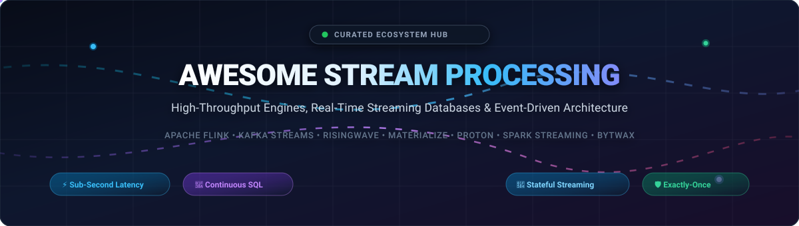

# ⚡ Awesome Stream Processing 🌊

  
  
  
  
  
  
  

  

### A Curated Directory of Stream Processing Engines, Streaming Databases, Managed SaaS Platforms & Real-Time Event Architecture

*Continuous SQL Analytics • Exactly-Once State Management • Sub-Second Latency Pipelines • Event-Driven Systems*

---

## 📑 Table of Contents

- [🎯 Overview & Architecture Landscape](#-overview--architecture-landscape)
- [🌐 Sector Overview & Market Dynamics](#-sector-overview--market-dynamics)
- [☁️ Managed SaaS & Cloud Platforms](#️-managed-saas--cloud-platforms)
- [🐙 Open-Source Stream Processing Projects](#-open-source-stream-processing-projects)
- [🧭 Architectural Decision Matrix](#-architectural-decision-matrix)
- [❓ Frequently Asked Questions (FAQ)](#-frequently-asked-questions-faq)
- [🤝 How to Contribute](#-how-to-contribute)
- [📈 Star History](#-star-history)
- [💖 Support & Community](#-support--community)
- [📜 Disclaimer & License](#-disclaimer--license)

---

## 🎯 Overview & Architecture Landscape

**Stream processing** is the paradigm of continuously ingesting, analyzing, transforming, and acting on unbounded streams of live data with sub-second latencies. Unlike traditional batch architectures that process bounded historical data at scheduled intervals, modern streaming systems evaluate continuous queries over dynamic time windows (tumbling, sliding, session) while preserving state across machine failures with **exactly-once processing guarantees**.

```mermaid
flowchart LR
    subgraph Sources ["📥 Event Sources"]
        direction TB
        Kafka["Apache Kafka"]
        Pulsar["Apache Pulsar"]
        CDC["Debezium / CDC"]
        IoT["IoT / Telemetry Sensors"]
    end

    subgraph Engines ["⚡ Stream Processing Layer"]
        direction TB
        Flink["Apache Flink / Spark"]
        KStreams["Kafka Streams / Bytewax"]
        StreamingDB["RisingWave / Materialize / Proton"]
    end

    subgraph Sinks ["📤 Low-Latency Targets"]
        direction TB
        OLAP["ClickHouse / Pinot / Iceberg"]
        Apps["Live Microservices & Dashboards"]
        Alerts["Real-Time Fraud & Anomaly Alerts"]
    end

    Sources -->|Continuous Event Logs| Engines
    Engines -->|Incremental Materialized Views & Sinks| Sinks
```

Key technical dimensions covered in this repository:
- **Streaming Engines vs. Streaming Databases**: Low-level computational frameworks (e.g., Apache Flink, Apache Spark) versus declarative SQL databases maintaining incremental materialized views over event streams (e.g., RisingWave, Materialize, Timeplus Proton).
- **Time Semantics & Windowing**: Handling event time, ingestion time, and processing time with watermarks for out-of-order and late-arriving records.
- **State Backends & Fault Tolerance**: Chandy-Lamport checkpointing, distributed changelogs, RocksDB state backends, and cloud-disaggregated object storage (S3/GCS tiering).

---

## 🌐 Sector Overview & Market Dynamics

The global **streaming analytics and event stream processing market** was valued at approximately **$26.8 Billion in 2024** and is projected to expand to **$105.4 Billion by 2032**, registering a compound annual growth rate (**CAGR of ~21.5%**), driven by surging demand for sub-second fraud detection, real-time personalization, AI agent contextual retrieval, and IoT edge processing.

The sector exhibits **moderate fragmentation**: while hyperscale cloud providers (Microsoft Azure, AWS, Google Cloud) command substantial market share through tightly integrated managed platforms, the computational layer remains fiercely contested and un-monopolized. Independent infrastructure leaders (Confluent, Databricks, Redpanda) alongside next-generation Rust- and C++-native streaming database innovators (RisingWave, Materialize, Timeplus) have prevented a single "winner-take-all" outcome, accelerating continuous SQL standardization, Lakehouse-streaming convergence (Apache Iceberg / Delta Lake), and serverless auto-scaling pricing models.

---

## ☁️ Managed SaaS & Cloud Platforms

The following table catalogs leading managed cloud platforms and SaaS offerings for stream processing, **ranked descending by company valuation / market capitalization**.

| Product | Parent Company & Scale / Valuation | Starting Tier Pricing | Free Tier / Trial Limits | Key Capabilities & Architecture |
| :--- | :--- | :--- | :--- | :--- |
| **[Azure Stream Analytics](https://azure.microsoft.com/en-us/products/stream-analytics/)** | **Microsoft** `~$3.1 Trillion Market Cap` *($245B+ Annual Rev)* | **$0.11 / Streaming Unit (SU) / hr** *(approx. $79.20/month per 1 SU)* or $0.014/hr on IoT Edge | **30-day trial with $200 credits** eligible across Stream Analytics SUs & Event Hubs, plus 55+ always-free services | Fully managed declarative SQL stream processing. Native integration with Azure Event Hubs, IoT Hub, Cosmos DB, and Fabric Lakehouse. Edge deployment available. |
| **[Google Cloud Dataflow](https://cloud.google.com/dataflow)** | **Alphabet (Google)** `~$2.1 Trillion Market Cap` *($350B+ Annual Rev)* | **$0.056 / vCPU-hr + $0.003557 / GB-hr RAM** *(Batch/Streaming worker; ~$1.50–$2.50/day min worker)* | **90-day trial with $300 in credits** across all Google Cloud services (no perpetual free streaming worker nodes) | Serverless execution engine for Apache Beam pipelines. Dynamic autoscaling, automated liquid sharding, exactly-once processing, and native BigQuery/PubSub streaming. |
| **[AWS Managed Service for Apache Flink](https://aws.amazon.com/managed-service-apache-flink/)** | **Amazon (AWS)** `~$2.0 Trillion Market Cap` *($575B+ Annual Rev)* | **$0.11 / KPU-hour** *(1 Kinesis Processing Unit = 1 vCPU + 4GB RAM; ~$79.20/mo)* + $0.10/GB-mo storage | **3-month free trial** granting up to 1 KPU-hour/day (31 KPU-hrs/month) for first-time Flink service users | Managed Apache Flink and Apache Beam runtime. Automatic state checkpointing, VPC peering, integration with Kinesis Data Streams, MSK (Managed Kafka), and S3. |
| **[Databricks Structured Streaming](https://www.databricks.com/product/structured-streaming)** | **Databricks** `$43 Billion Valuation` *($2.4B+ ARR)* | **$0.07 to $0.55 / DBU** *(Jobs Compute starts at $0.07/DBU; All-Purpose/SQL at $0.22–$0.55/DBU + cloud VM)* | **14-day full platform free trial** with unlimited DBU usage + perpetual free Databricks Community Edition (1 micro-cluster) | Spark-based stream processing unifying batch and streaming via Delta Lake engine. End-to-end exactly-once fault tolerance with ACID transaction guarantees. |
| **[Confluent Cloud](https://www.confluent.io/product/ksqldb/)** | **Confluent** `~$7.2 Billion Market Cap` *($915M+ ARR, NASDAQ: CFLT)* | **$0.12 / CSU-hour** *(ksqlDB)* & **$0.15 / CFU-hour** *(Managed Flink)*; Kafka clusters start at $0.05/hr | **$400 in free credits valid for 30 days** across Kafka, ksqlDB, and Managed Apache Flink (no card required to start) | Enterprise Kafka platform with managed Apache Flink and ksqlDB. Push and pull continuous queries, Schema Registry, Stream Governance, and 120+ managed connectors. |
| **[Redpanda Cloud](https://redpanda.com/)** | **Redpanda Data** `~$500 Million Valuation` *($165M Venture Raised)* | **$0.20 / broker-hour** for Serverless/BYOC *(approx. $144/month)* or $0.06/GB streaming ingress | **14-day free trial with $300 usage credits** covering Serverless, Dedicated, or Bring-Your-Own-Cloud (BYOC) | C++-native Kafka-compatible streaming engine with built-in Redpanda Connect (Benthos) stream processing. Zero JVM dependencies and direct S3 tiered storage. |
| **[Hazelcast Cloud](https://hazelcast.com/products/viridian/)** | **Hazelcast Inc.** `~$400 Million Valuation` *($100M+ Venture Raised)* | **$0.10 / hour** for dedicated Viridian Starter 0.5 GB memory instance *(approx. $73/month)* | **Free Forever plan** offering 1 cluster with up to 2 GB memory and 250 MB monthly data transfer (no credit card needed) | In-memory computing platform fusing low-latency stream processing (Hazelcast Jet) with high-throughput distributed memory caches for stateful computations. |
| **[Materialize Cloud](https://materialize.com/)** | **Materialize Inc.** `~$250 Million Valuation` *($100M+ Venture Raised)* | **$0.35 / cluster credit / hour** *(Size `2xsmall` compute engine = $0.35/hr; ~$252/month base)* | **14-day free trial with $200 credits** with multi-cluster compute, Kafka/PostgreSQL CDC connectors, and UI | Streaming database based on Timely & Differential Dataflow. Maintains complex SQL materialized views incrementally with sub-second latency and ANSI PostgreSQL protocol. |
| **[Decodable](https://www.decodable.co/)** | **Decodable Inc.** `~$150 Million Valuation` *($35M+ Venture Raised)* | **$0.25 / DPU-hour** *(Data Processing Unit; ~$180/month for 1 continuous pipeline DPU)* | **Free Developer Plan forever**: up to 2 DPUs, 10 continuous streaming pipelines, and 50 GB processed data/month | Serverless stream processing platform powered by Apache Flink and Debezium. Build real-time streaming ETL pipelines using standard SQL without cluster operations. |
| **[StreamNative Cloud](https://streamnative.io/)** | **StreamNative** `~$120 Million Valuation` *($40M+ Venture Raised)* | **$0.15 / PPU-hour** *(Pulsar Processing Unit)* or **$99/month base** for Serverless Starter tier | **14-day free trial with $300 in cloud credits** across Pulsar messaging, Kafka protocol handlers, and Ursa engine | Cloud-native messaging and streaming architecture built on Apache Pulsar and Apache BookKeeper. Supports Pulsar Functions and multi-tenant tiered storage. |
| **[Timeplus Cloud](https://www.timeplus.com/)** | **Timeplus Inc.** `~$40 Million Valuation` *($10M+ Venture Raised)* | **$0.08 / compute unit / hour** *(Pro tier starts at $150/month base subscription)* | **Free Community Tier forever**: 3 real-time streams, 1 GB storage, up to 50,000 events/sec throughput + 30-day Pro trial | High-performance streaming analytics engine powered by ClickHouse and Proton. Features single-binary C++ architecture, streaming SQL, and historical querying. |

---

## 🐙 Open-Source Stream Processing Projects

The open-source streaming ecosystem provides production-proven engines for self-hosting, stateful processing, and building custom real-time event platforms. **Sorted descending by GitHub stargazer count.**

1. **[Apache Spark](https://github.com/apache/spark)**   
   **Unified analytics engine for large-scale data processing & Structured Streaming.**  
   Provides a high-level DataFrame and Dataset API for expressively building stream processing pipelines. Features continuous micro-batch and low-latency execution engines, stateful window aggregations, watermarking, and seamless integration with Delta Lake and Apache Iceberg for streaming Lakehouse architectures. *(Apache 2.0)*

2. **[Apache Kafka (Kafka Streams)](https://github.com/apache/kafka)**   
   **Distributed event streaming platform with client library for stateful stream processing.**  
   Kafka Streams is a lightweight Java/Scala client library for building real-time mission-critical applications and microservices. Features built-in RocksDB state stores, stream-table duality (KStream/KTable), exactly-once processing semantics (`processing.guarantee=exactly_once_v2`), and zero dedicated cluster infrastructure requirements outside of Kafka brokers. *(Apache 2.0)*

3. **[Apache Flink](https://github.com/apache/flink)**   
   **The industry standard framework for stateful distributed computations over unbounded streams.**  
   Features true event-driven stream processing (event-by-event pipelined execution), sophisticated event-time handling with watermarks, asynchronous Chandy-Lamport state snapshotting, savepoint-based live schema upgrades, and ANSI-compliant Flink SQL. Deploys seamlessly on Kubernetes, YARN, or standalone compute clusters. *(Apache 2.0)*

4. **[Vector](https://github.com/vectordotdev/vector)**   
   **High-performance, memory-safe observability data pipeline written in Rust.**  
   Engineered for streaming ingestion, transformation, and routing of logs, metrics, and events. Features Vector Remap Language (VRL) for expressive, sandboxed data shaping at millions of events per second with minimal memory footprint and zero garbage collection overhead. *(MPL 2.0)*

5. **[NATS JetStream](https://github.com/nats-io/nats-server)**   
   **Cloud-native, ultra-lightweight pub-sub messaging system with persistent stream processing.**  
   Written in Go, JetStream provides at-least-once and exactly-once stream delivery, deduplication, consumer horizontal scaling, subject-based routing, key-value storage, and multi-region stream replication with extreme simplicity and sub-millisecond dispatch times. *(Apache 2.0)*

6. **[Apache Pulsar](https://github.com/apache/pulsar)**   
   **Cloud-native distributed messaging and streaming platform with multi-tenancy and tiered storage.**  
   Separates compute (stateless broker nodes) from storage (Apache BookKeeper bookie nodes). Incorporates Pulsar Functions for lightweight stream computation without deploying an external streaming cluster, alongside native protocol compatibility for Kafka and AMQP. *(Apache 2.0)*

7. **[RisingWave](https://github.com/risingwavelabs/risingwave)**   
   **PostgreSQL-compatible distributed streaming database engineered in Rust.**  
   Consolidates ingestion, stateful stream processing, and serving into a single engine. Continuously maintains materialized views over Kafka, Pulsar, and database CDC logs with sub-second freshness. Leverages disaggregated compute-storage architecture storing persistent state in S3-compatible object stores to slash operating costs. *(Apache 2.0)*

8. **[Redpanda Connect (formerly Benthos)](https://github.com/redpanda-data/connect)**   
   **Declarative stream processor with 200+ connectors for low-overhead streaming pipelines.**  
   Written in Go, Redpanda Connect solves real-world streaming ETL, hydration, and routing via declarative YAML configs and Bloblang mapping language. Operates with zero external dependencies as a single self-healing binary. *(Apache 2.0)*

9. **[Apache Beam](https://github.com/apache/beam)**   
   **Unified, multi-language programming model for batch and streaming pipelines.**  
   Provides expressive SDKs in Java, Python, and Go. Pipelines defined in Beam are portable across diverse distributed execution backends, including Apache Flink, Apache Spark, and Google Cloud Dataflow. *(Apache 2.0)*

10. **[Apache Storm](https://github.com/apache/storm)**   
    **Classic distributed real-time computation system for high-throughput stream processing.**  
    Pioneered the Spouts and Bolts abstraction for constructing real-time directed acyclic graphs (DAGs). Provides fault-tolerant stream transformations with at-least-once or Trident transactional micro-batch processing semantics. *(Apache 2.0)*

11. **[Materialize](https://github.com/MaterializeInc/materialize)**   
    **Incremental streaming database engineered on Differential Dataflow in Rust.**  
    Maintains complex multi-way SQL joins, aggregations, and windowed views incrementally. Changes from Kafka and PostgreSQL CDC update query views with single-digit millisecond latency while speaking standard PostgreSQL wire protocol. *(BSL / Cloud SaaS)*

12. **[Fluvio](https://github.com/fluvio-community/fluvio)**   
    **Lean, composable event stream processing platform powered by Rust and WebAssembly.**  
    Enables developers to execute programmable SmartModules (Wasm filters, mappers, and aggregators) directly inside the streaming engine at the storage layer, slashing data transmission overhead. *(Apache 2.0)*

13. **[Arroyo](https://github.com/ArroyoSystems/arroyo)**   
    **Distributed stream processing engine in Rust designed for stateful continuous SQL.**  
    Built from the ground up to replace JVM-based streaming engines with native performance, sub-second checkpoints, and Rust reliability. Generates compiled Rust pipelines from standard SQL expressions with automatic scaling and web-based pipeline monitoring. *(Apache 2.0)*

14. **[Memphis.dev](https://github.com/superstreamlabs/memphis)**   
    **Developer-centric message broker and event stream processing platform.**  
    Focuses on developer ergonomics with built-in schema management (Protobuf, JSON, Avro), in-line stream functions, automated dead-letter queues (DLQ), and out-of-the-box telemetry. *(Apache 2.0)*

15. **[Timeplus Proton](https://github.com/timeplus-io/proton)**   
    **High-performance unified streaming SQL engine in a single C++ binary.**  
    Leverages ClickHouse columnar libraries and SIMD hardware acceleration to achieve up to 90 million events per second with 4ms end-to-end latency. Unifies streaming queries and historical analytical queries within a single lightweight binary under 500 MB. *(Apache 2.0)*

16. **[Feldera](https://github.com/feldera/feldera)**   
    **Incremental computation engine executing arbitrary SQL programs on continuous data.**  
    Based on mathematical theory of DBSP (database stream processing). Evaluates complex queries, recursive graph algorithms, and multi-table joins incrementally on changing datasets without periodic full recomputations. *(Apache 2.0)*

17. **[Bytewax](https://github.com/bytewax/bytewax)**   
    **Python-native stateful stream processing framework powered by a Timely Dataflow Rust core.**  
    Brings modern stream processing ergonomics to the Python data science and machine learning ecosystem. Features native integration with PyTorch, pandas, Kafka, and WebSockets for real-time feature engineering. *(Apache 2.0)*

18. **[Faust Streaming](https://github.com/faust-streaming/faust)**   
    **Python library for building event-driven streaming microservices on Apache Kafka.**  
    Maintained fork of Robinhood Faust. Employs Python `asyncio` semantics, RocksDB table state stores, and type-annotated stream channels to replicate Kafka Streams idioms in pure Python. *(Apache 2.0)*

19. **[LF Edge eKuiper](https://github.com/lf-edge/ekuiper)**   
    **Lightweight stream processing engine designed for IoT edge devices and industrial gateways.**  
    Developed under the Linux Foundation Edge. Requires under 10 MB memory footprint, written in Go, and supports MQTT/OPC UA protocol parsing with SQL rule engines and AI inference integration. *(Apache 2.0)*

20. **[Quix Streams](https://github.com/quixio/quix-streams)**   
    **Python streaming DataFrame library engineered for Apache Kafka and Redpanda.**  
    Combines pandas-like syntax with enterprise stream processing guarantees: local RocksDB state, exactly-once processing, windowing, and sliding joins for real-time ML pipelines. *(Apache 2.0)*

21. **[Apache Samza](https://github.com/apache/samza)**   
    **Distributed stream processing framework with stateful processing and fault tolerance.**  
    Originally developed at LinkedIn. Couples Kafka with Apache YARN or runs standalone to process petabyte-scale stateful pipelines with sub-second SLA guarantees. *(Apache 2.0)*

22. **[ksqlDB](https://github.com/confluentinc/ksql)**   
    **The purpose-built streaming database for event processing on Apache Kafka.**  
    Exposes an intuitive SQL syntax over Kafka Streams under the hood. Supports push queries (continuous stream subscriptions) and pull queries (point-in-time state lookup), simplifying stream ETL and anomaly detection without writing bespoke Java applications. *(Confluent Community License)*

---

## 🧭 Architectural Decision Matrix

Selecting the right streaming engine depends on latency constraints, SQL support, language ecosystem, and state requirements:

| Processing Engine | Core Language | Primary Abstraction | State Management | Best Use Case Fit |
| :--- | :--- | :--- | :--- | :--- |
| **Apache Flink** | Java / Scala | Stream DAG / Flink SQL | RocksDB / Heap Snapshots | Complex distributed stateful logic, strict SLAs, custom operators |
| **Kafka Streams** | Java | Stream-Table (KStream/KTable) | Embedded RocksDB | Microservices embedded within Kafka-centric infrastructure |
| **RisingWave** | Rust | Streaming SQL Database | S3 / Tiered Object Store | PostgreSQL-compatible streaming analytics replacing Flink+Postgres |
| **Spark Streaming** | Scala / Python | Micro-Batch / DataFrames | Delta Lake / HDFS checkpoint | Unified batch/stream analytics within existing Data Lakehouse stacks |
| **Arroyo** | Rust | Streaming SQL Engine | Distributed object store | High-performance Rust-native continuous SQL pipelines |
| **Timeplus Proton** | C++ | Continuous SQL + Historical | Columnar / SIMD memory | Ultra-low latency edge/server real-time metric & log analysis |
| **Bytewax / Quix** | Python / Rust | Dataflow / DataFrames | Embedded RocksDB | Python-first real-time AI/ML feature pipelines and data science |
| **Vector / Connect** | Rust / Go | Declarative YAML / Pipelines | In-flight buffer | High-volume observability, routing, scrubbing, and data ingestion |

---

## ❓ Frequently Asked Questions (FAQ)

<b>1. What is the difference between Stream Processing and Batch Processing?</b>

 
Batch processing processes bounded, historical data at scheduled intervals (hourly, daily) with high throughput and latency ranging from minutes to hours. Stream processing processes unbounded data continuously as events arrive, computing results with sub-second latencies and incremental state updates.

<b>2. How does Exactly-Once Processing (EOS) work in streaming engines?</b>

 
Exactly-once processing ensures that every event influences the final state exactly once, even during worker crashes or network partitions. This is typically achieved via two-phase commit protocols (2PC) between the source, stateful engine (via Chandy-Lamport checkpointing), and idempotent/transactional sinks (such as Kafka transactional producers or Delta Lake ACID commits).

<b>3. What are Watermarks and why are they necessary?</b>

 
Watermarks are temporal control signals emitted by stream sources or operators that assert: <i>"No events with a timestamp earlier than time $t$ will arrive from this point onward."</i> Watermarks enable stream engines to handle out-of-order and delayed events predictably and determine when to close time windows and trigger windowed calculations.

<b>4. When should I choose a Streaming Database (e.g., RisingWave, Materialize) over Apache Flink?</b>

 
Choose a <b>streaming database</b> when your pipeline logic can be expressed in standard SQL, you want to query materialized views directly via PostgreSQL wire protocol without spinning up downstream databases, and you seek to avoid complex JVM cluster management. Choose <b>Apache Flink</b> when you require procedural Java/Scala code, complex finite state machines, arbitrary window triggers, or integration with heterogeneous custom connectors.

<b>5. Can I use Python for production stream processing?</b>

 
Yes! Frameworks such as <b>Bytewax</b> (powered by a Rust Timely Dataflow core), <b>Quix Streams</b> (powered by C++ librdkafka and RocksDB), and <b>PyFlink</b> provide Python developer ergonomics combined with the raw computational performance and memory safety of compiled systems.

---

## 🤝 How to Contribute

Contributions are warmly welcomed! Help keep this repository up-to-date with emerging tools, benchmarks, and architectures:

1. 🍴 **Fork the repository** to your personal GitHub account.
2. 🌿 **Create a descriptive feature branch** (`git checkout -b feature/add-streaming-engine`).
3. 📝 **Add or update the entry** following the existing markdown table and list formatting:
   - Provide verified official documentation and repository links.
   - For SaaS tools: Include specific starting prices, parent company valuation, and exact free tier/trial limits.
   - For Open-Source tools: Include the `style=social&color=white` shields.io star badge linked to `/stargazers`.
4. 🚀 **Submit a Pull Request** with a concise summary of additions.

Refer to the curated collection at [Awesome-Awesome-Awesome](https://github.com/ishandutta2007/Awesome-Awesome-Awesome) for complementary curated software lists.

---

## 📈 Star History

---

## 💖 Support & Community

Thank you for exploring this curated repository! If you find this guide valuable for your real-time data engineering work or streaming architecture decisions:

- ⭐ **Star this repository** to help fellow engineers discover it and receive ecosystem updates.
- 🍴 **Fork & Contribute** to expand coverage and ensure pricing and benchmark figures remain current.
- 📢 **Share with colleagues** building event-driven microservices, CDC pipelines, and Lakehouses.
- ☕ **Sponsor the Maintainer**: Support ongoing open-source curation and maintenance via the [GitHub Sponsor Dashboard](https://github.com/sponsors/ishandutta2007).

---

## 📜 Disclaimer & License

- **Disclaimer**: This is a community-maintained catalog and does not constitute an endorsement. Benchmark figures, cloud CSU/KPU rates, and venture valuations fluctuate over time; always verify against official vendor pricing calculators and enterprise contracts.
- **License**: Released under the [MIT License](LICENSE).
